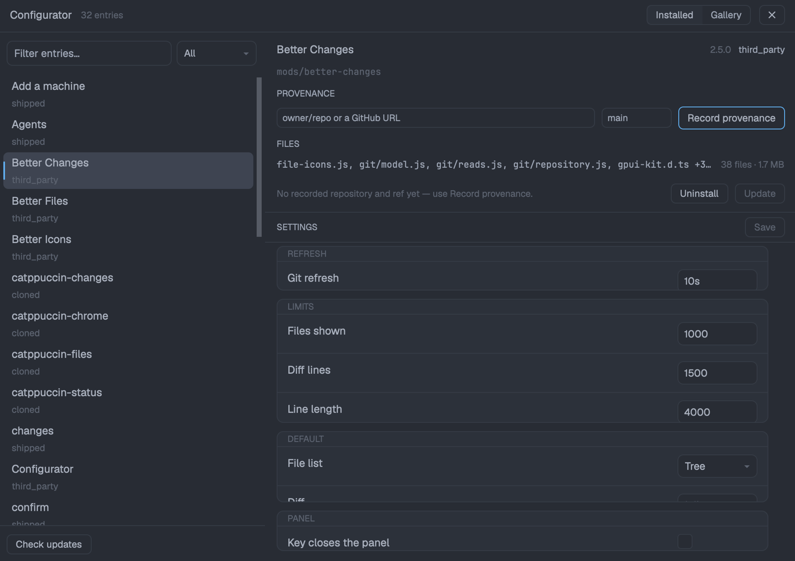

# Configurator

One dialog for everything you have installed under `~/.config/herdr-app/mods/`: what it is,
where it came from, whether its upstream has moved, and what it is set to. A 26 px strip at
the bottom of the window holds the button that opens it. It replaces `better-config`, which
edited mod settings but knew nothing about provenance, updates or uninstalling.

## What you see

**The strip.** 26 px tall, along the bottom edge, one row, right-aligned: a gear glyph and
the word "Configurator" in the ui font at 12 px, the theme's `chrome` background, a 1 px
`border` line on its top edge. It is the mod docked (`place: "bottom"`, `size: 26`); nothing
else is drawn there.

**The dialog** (`mod.open:configurator`, or the strip's button). 960 × 680, Herdr draws the
frame, the shadow and the title; the mod draws three regions:

- Left column, 320 px, `surface` background, a full-height `Scrollbar`: one row per entry,
  32 px. Each row: a 14 px glyph for its origin (a herd glyph for `shipped`, a copy glyph for
  `cloned`, a link glyph for `third_party`, a question glyph for unknown), the title at 13 px,
  the version at 11 px in a dim tone when `mod.json` has one, and — on `third_party` entries
  that were checked — a dot: `accent` when upstream moved, `border` when not, nothing when
  never checked. Selected row: `accent` at 12% alpha. Under it, a sticky row of two buttons:
  `刷新列表` (31 px tall, `surface`) and `检查更新`.
- Right, top, 200 px: the detail of the selected entry — title, origin word, folder path in
  monospace 11 px, `repo` and short `commit` (or "来源未知"), 上次检查 time, the entry's files
  with their sizes, and the reference scan's answer ("被 3 个布局引用：main、terminals、win98").
  Bottom-right of this block: `更新`, `卸载`, `打开` (for `place: none` entries that have an
  overlay).
- Right, bottom, the rest: settings for the selected entry, drawn like Herdr's own Settings —
  grouped by the schema's first path segment, one row per field: label 13 px on the left, the
  control 96 px from the right edge — text `Input`, `Select` for enums, `Checkbox` for booleans,
  a duration/size input with its unit label. A field the person changed carries a dot; hover
  shows the schema's description under the label at 11 px. With no `mod.schema.json` and no
  `settings` block: one dim line, "这个 mod 没有可配置的项".

Colors are theme names, never hex: `surface`, `chrome`, `border`, `accent`, and text tones.
Every size is px, since mod text sizes are their own and follow the app's zoom.

## How it behaves

- **Strip click** — `run("mod.open", {name: "configurator"})`. Hovering tints the gear to
  `accent`.
- **Selecting a row** — detail and settings swap in place; the settings drafts of the entry
  you left are kept until the dialog closes (no silent discarding).
- **刷新列表** — one GitHub topic search (`herdr-mod`, `per_page=100`, every page) into
  `data/configurator/gallery.json`; the list shows repos with their stars, description and
  last push. A second tab, "已安装", is the default and needs no network.
- **安装** — on a gallery row: `git clone --depth 1` into a temp folder, copy `mods/<name>/`
  to `mods/` (renamed `-copy` when taken), write the ledger entry with the commit and per-file
  hashes, then `herdr-app check` it. Keys the repo ships: only non-conflicting ones are
  offered, each listed as text with a copy button. Conflicts are listed, never applied.
- **检查更新** — one `GET /repos/{owner}/{repo}/commits/{ref}` per `third_party` entry that has
  provenance; nothing else. A newer commit lights the row's dot. Failure shows the response's
  own error line; it never guesses. No polling, no timer, no check on open.
- **更新** — clone to temp, compare every file's hash with the ledger: if the local copy
  changed, the dialog asks first and offers "备份后覆盖" or "取消"; otherwise it replaces the
  files, keeps `data/<name>/` untouched, re-checks the mod, and rewrites the ledger entry.
- **卸载** — a confirm panel lists the reference scan (layouts that name this mod, `keys.json`
  sections `mod:<name>`) and moves the folder to `data/configurator/trash/<time>/`. Nothing is
  ever deleted. `shipped` entries cannot be uninstalled (Herdr restores them anyway) and
  `cloned` ones are grey-wrapped in that explanation.
- **Settings** — a save writes only the changed keys into the entry's `mod.json` `settings`
  block, plus a copy under `data/configurator/kept/<name>.json`, the way better-config did;
  Herdr reloads the mod when the file is saved. Nothing is written while the value is invalid.
- **Search box** above the list filters by title and folder name as you type.
- Nothing animates; nothing moves except the list's scroll and the selected row's tint.

## Built from

- `mods/configurator/mod.json`: `{"place":"bottom","size":26,"title":"Configurator",
  "overlay":{"kind":"dialog","width":960,"height":680}}`. One folder, two copies: the docked
  one draws the strip (no `overlay` in `props()`), the overlay one draws the dialog (`props()
  .overlay` is set).
- `main.js`: `class Configurator extends View`, `init` builds handles and loads the ledger;
  `render` branches on `props().overlay`. Elements from `gpui-kit` (`div`, `svg`, `img`,
  `text`) and `gpui-base` (`v_flex`, `h_flex`, `Scrollbar`, `InputState`, `Input`, `Select`,
  `Checkbox`, `Popup`).
- `model.js`: no Herdr calls, so `node --test` runs it — schema → fields, ledger read/write
  shape, sha256 compare, key conflict detection, gallery response → rows.
- `herdr` calls: `appHome`, `home`, `exec` (`git`, `/bin/sh` for `ls`/`mv`), `readTextFile`,
  `writeTextFile(path, text, expected)` for every write, `run` (`mod.open`, `overlay.close`,
  `layout.switch`), `props`, `notify`, `layouts()`, `keys()`, `theme()`, `checking()`.
  `fetch` (built-in) for `api.github.com`, unauthenticated: 60 requests/hour.
- Runs `git clone --depth 1`, `herdr-app check <folder>`, and `herdr-app do layout.switch`.
- Icons: four 14 px SVGs under `mods/configurator/icons/`, drawn with `svg(...)` so they follow
  the text color.
- Settings schema: `mod.schema.json` (this mod's own), read at runtime from each entry's
  `mods/<name>/mod.schema.json` — the convention `better-*` mods already follow.
- Art: none; the preview is `herdr-app shot`, cropped to the dialog.

## Watch out

- **No `setTimeout`, no DOM, no Node.** Everything slow goes through `exec`, `fetch` or
  `cx.spawn`; a poll is `cx.timer`. Top-level side effects must stay off the module: a broken
  save keeps the old build running and runs the module's top level again.
- **`checking()`**: `init` runs for real during `herdr-app check`, so all reading, cloning and
  writing sits behind `if (checking()) return;`. Without it, a check would rewrite the
  person's ledger.
- **The first sight of the folder docks the strip.** One copy appears in every layout;
  removing it means deleting the docked block from a layout, or setting it `hidden`.
- **The ledger dies with `data/configurator/` only if the person deletes it.** Uninstalling
  this mod leaves the ledger behind on purpose (it holds provenance for entries that outlive
  the dialog).
- **Unknown origin is normal**: anything hand-dropped into `mods/` has no provenance and can
  be configured and uninstalled but never checked or updated, until linked to a repository.
- **Rate limits**: 60 requests/hour without a token. "检查更新" on a person with 20 tracked
  entries uses 20; pressing it five times drains the hour. The list shows the response's
  rate-limit message rather than retrying.
- **V1 has no layouts at all** — the API has `layouts()` but the ledger, the scan and the
  dialog ignore `layouts/*.json` except as references to mods.
- **Two copies, one module**: `data` is per copy; anything shared between the strip and the
  dialog goes through `setShared`.
- **Sizes**: 960×680 is a dialog default, not a minimum — narrow windows clip the left column
  first. The list caps at 40 rows per screen; `Scrollbar` handles the rest.
- Controls that do nothing yet: `打开` appears only for entries whose `mod.json` has an
  `overlay`; a mod with `place` set is opened from its own dock instead.

## Done when

- `herdr-app check ~/.config/herdr-app/mods/configurator` exits 0.
- The strip appears at the bottom after the folder is first seen; clicking it opens the
  dialog; `herdr-app shot` shows both.
- The dialog lists every folder under `mods/`, with `shipped` / `cloned` / `third_party`
  told apart correctly (a `cloned_from` entry shows `cloned`, `better-config` shows
  `third_party` and unknown origin).
- `检查更新` on `better-changes` (repo linked by hand once) lights its dot when upstream is
  ahead, and says "up to date" when not.
- `卸载` on a throwaway mod moves its folder into `data/configurator/trash/<time>/` and the
  dialog says which layouts referenced it before doing so.
- A settings save on `better-changes` writes `settings` into its `mod.json`, and the mod
  reloads with the new value.
- `node --test mods/configurator/*.test.js` passes for `model.js`.
